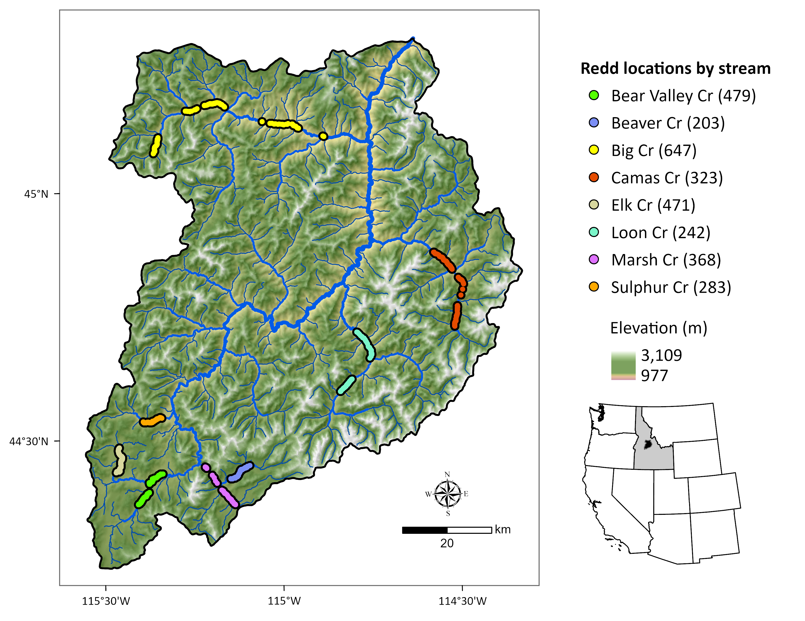

# Chinook salmon spawning phenology — Middle Fork Salmon River



This repository contains data and code supporting the manuscript:

> **Network-scale thermal heterogeneity is associated with a diverse Chinook salmon spawning portfolio**
> Russell F. Thurow\*, Bryan M. Maitland\*, Morgan M. Sparks, Daniel J. Isaak, and John M. Buffington
> \*Joint first authors. *Canadian Journal of Fisheries and Aquatic Sciences*, manuscript cjfas-2026-0215 (revision submitted November 2026).

We analyze 3,016 georeferenced Chinook salmon redds in 104 stream reaches of the Middle Fork Salmon River (MFSR), Idaho, USA (2002–2005), together with modeled daily stream temperatures (Siegel et al. 2023), to ask how reach-scale thermal regimes are associated with spawn timing.

---

## The revised analysis in brief

The first submission used `temp_90`, the mean temperature over the 90 days ending on each redd's own spawn date. Because spawning follows the late-July thermal peak, that window becomes warmer as spawn date gets later, so it is correlated with spawn date by construction (Appendix A2). The revision replaces it with a **fixed-date thermal index**:

- **Index:** mean modeled temperature from 18 May to 16 July (60 days) for each reach and year. It ends before the first redd and does not depend on when any fish spawned.
- **Split:** the index is separated into each reach's mean (`T_bar`, between reaches) and each reach-year's departure from it (`T_dev`, within reaches; van de Pol & Wright 2009).
- **Final model** (`lme4`):

  ```r
  yday ~ T_bar + T_dev + stream + year + (1 | COMID) + (1 | key)   # key = reach-year
  ```

- **Calendar:** all day-of-year values use a non-leap calendar, so a given date has the same value in 2004 as in other years.

The index settings (`INDEX_END_DOY`, `INDEX_N`) and `FINAL_FORMULA` are defined once, in `R/revision_setup.R`.

---

## Project structure

```
mfsr_phenology/
│
├── data/
│   ├── raw/russ_spawn/              # Original redd-monitor XLS files + data notes
│   └── processed/
│       ├── russ_spawn/              # Cleaned and compiled redd data (mfsr_spawn_cleaned.csv)
│       ├── siegel_temperature/      # Siegel et al. (2023) daily temperatures for surveyed reaches
│       ├── gis/                     # NHDPlus V2 flowlines, HUC8 boundaries, study streams
│       ├── comid_temps.RData        # Date-anchored windows from the first submission (used in R/07)
│       ├── elevslope.rds            # NHDPlus reach elevation and slope
│       └── mfsr_flow.csv, ...       # USGS discharge (gauge 13309220)
│
├── R/
│   ├── 01_compile-spawn-data.R      # Data pipeline (first submission)
│   ├── 02_clean-spawn-data.R
│   ├── 03_process-siegel-temps.R
│   ├── 04_comid-temperature.R
│   ├── 05_flow-covariates.R
│   ├── 06_temp-compare-isaak-seigel.R   # Modeled vs empirical temperature (Appendix A1)
│   │
│   ├── revision_setup.R             # Shared settings, data, window functions, model_data(), helpers
│   ├── 07_window-artifact-diagnostics.R # Why temp_90 was replaced (Appendix A2)
│   ├── 08_fixed-date-index.R        # Candidate fixed-date indices; post-spawn indices (A3, A6)
│   ├── 09_refit-fixed-date-model.R  # Model comparison, final model, contrasts, sensitivity (A4–A6)
│   ├── 10_manuscript-figures.R      # Figures 2–5
│   ├── 11_manuscript-tables.R       # Tables 1–2
│   ├── 12_long-term-thermal-context.R   # Study years in the 1990–2021 record (A7)
│   ├── 13_window-variability.R      # exploratory
│   │
│   ├── palettes-themes.R            # Colour palettes and theme_mfsr()
│   ├── utils.R                      # Table helpers (used by R/11)
│   └── archive/                     # Superseded or exploratory scripts
│
├── analysis/
│   ├── appendix-rev/                # Appendix sections, one child file each (_A1 … _A7)
│   └── archive/                     # Appendix fragments from the first submission
│
├── appendix/
│   ├── appendix.qmd                 # Supplementary appendix (renders to PDF)
│   └── appendix.pdf
│
├── plots/
│   ├── ms/                          # Figures from the first submission
│   └── revision/                    # Revised figures (Figure_0X_rev) and appendix figures
│
├── tables/
│   ├── ms/                          # Tables from the first submission
│   └── revision/                    # Revised tables (Table_0X_rev) and appendix tables
│
├── docs/
│   ├── ms/                          # Manuscript versions, first submission
│   └── revision/                    # Revised text, figures, tables, response to reviewers
│
└── mfsr_phenology.Rproj
```

Outputs of R/07–R/12 are prefixed by analysis step, which matches the script and the appendix section that uses them:

| Prefix | Script | Content | Appendix |
|---|---|---|---|
| `D` | R/07 | Date-anchored window diagnostics, shuffled-date null | A2 |
| `E` | R/08 | Fixed-date index candidates (`E1`); post-spawn indices (`E2`) | A3, A6 |
| `F` | R/09 | Model comparison, final model, contrasts, reach effects, elevation | A4–A6 |
| `G` | R/12 | Long-term thermal context, 1990–2021 | A7 |
| `Figure_0X_rev`, `Table_0X_rev` | R/10, R/11 | Manuscript figures and tables | — |

---

## How to reproduce the analysis

### Prerequisites

- R ≥ 4.3 and [Quarto](https://quarto.org) ≥ 1.4 with a TeX installation (`quarto install tinytex`); the appendix renders with XeLaTeX
- R packages: `tidyverse`, `here`, `lme4`, `emmeans`, `performance`, `splines`, `hatchR`, `patchwork`, `ggridges`, `kableExtra`, `knitr`, `DBI`, `RSQLite`; optional `gt` (Word versions of Tables 1–2)
- On macOS, saving PDF figures with `cairo_pdf` requires [XQuartz](https://www.xquartz.org)

### Step 1 — Data pipeline (only needed to rebuild `data/processed/`)

The processed data used by the revision are already in `data/processed/`. To rebuild them, run R/01–R/05 in order.

> **Note:** `R/03_process-siegel-temps.R` requires the full Siegel et al. (2023) temperature dataset from https://zenodo.org/records/8174951. Download it to a local directory and update the path in that script.

### Step 2 — Revised analysis

Run the revision scripts in order from the project root. Each sources `R/revision_setup.R` and writes to `tables/revision/` and `plots/revision/`.

```r
source("R/07_window-artifact-diagnostics.R")  # D: temp_90 diagnostics (~200 permutations; a few minutes)
source("R/08_fixed-date-index.R")             # E: index selection, post-spawn indices
source("R/09_refit-fixed-date-model.R")       # F: model comparison, final model, sensitivity
source("R/10_manuscript-figures.R")           # Figures 2–5
source("R/11_manuscript-tables.R")            # Tables 1–2
source("R/12_long-term-thermal-context.R")    # G: long-term context
```

### Step 3 — Render the supplementary appendix

The appendix reads the tables and figures written in Step 2, so run those scripts first. Then, from the project root:

```bash
quarto render appendix/appendix.qmd
```

This produces `appendix/appendix.pdf`. Sections are child files in `analysis/appendix-rev/` and share one R session started by the setup chunk in `appendix.qmd`.

### Working interactively

To explore the data or the model, run:

```r
source(here::here("R", "revision_setup.R"))
d <- model_data()                         # one row per redd, with T, T_bar, T_dev
fit <- lme4::lmer(FINAL_FORMULA, data = d, control = ctl)
```

---

## Appendix contents

| Section | Topic |
|---|---|
| A1 | Data and study design; modeled vs empirical temperatures |
| A2 | Why the date-anchored 90-day window was replaced |
| A3 | Choosing a fixed-date thermal index |
| A4 | Model structure, selection and diagnostics |
| A5 | Final model results; stream and year means; reach effects |
| A6 | Sensitivity analyses: elevation, reach slope, post-spawn indices, discharge |
| A7 | The study years in the 1990–2021 thermal record |

---

## Data sources

| Dataset | Source | Location |
|---|---|---|
| Chinook salmon redd data | R. Thurow, USDA Forest Service | `data/raw/russ_spawn/`, `data/processed/russ_spawn/` |
| Modeled daily stream temperatures | Siegel et al. (2023), [Zenodo](https://zenodo.org/records/8174951) | `data/processed/siegel_temperature/` |
| Reach elevation, slope, drainage area | NHDPlus Version 2 (McKay et al. 2012) | `data/processed/elevslope.rds`, `data/processed/gis/` |
| Streamflow | USGS gauge 13309220 (Middle Fork Lodge) | `data/processed/mfsr_flow.csv` |
| Watershed boundaries | WBD HUC8 | `data/processed/gis/` |

---

## Citation

If you use these data or code, please cite the article (citation to be added on publication).
